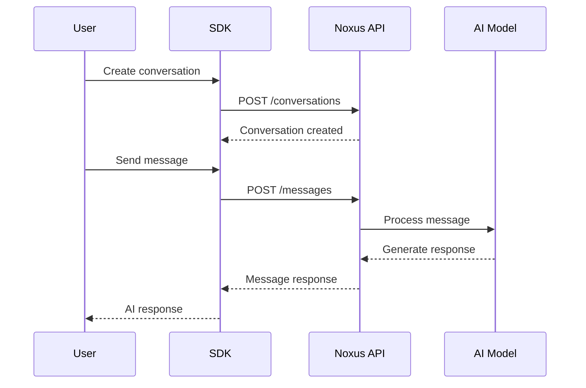

## What are Conversations?

Conversations in Noxus represent interactive chat sessions with AI models. They provide a structured way to build chatbots, virtual assistants, and other conversational AI applications with support for multiple AI models, custom tools, context management, and file handling.


## Key Features

<CardGroup cols={2}>
  <Card title="Multi-Model Support" icon="brain">
    Choose from various AI models including GPT-4, Claude, and more
  </Card>
  <Card title="Tool Integration" icon="wrench">
    Enhance conversations with web search, knowledge bases, and custom tools
  </Card>
  <Card title="Context Management" icon="memory">
    Maintain conversation history and context across multiple interactions
  </Card>
  <Card title="File Handling" icon="file">
    Process and discuss documents, images, and other file types
  </Card>
  <Card title="Async Support" icon="bolt">
    Build responsive applications with asynchronous operations
  </Card>
  <Card title="Customizable Settings" icon="gear">
    Fine-tune model parameters, temperature, tokens, and behavior
  </Card>
</CardGroup>

## Core Concepts

### Conversation Settings

Every conversation is configured with settings that control its behavior:

```python
from noxus_sdk.resources.conversations import ConversationSettings

settings = ConversationSettings(
    model=["gpt-4o-mini"],           # AI model(s) to use
    temperature=0.7,                 # Creativity level (0.0-1.0)
    max_tokens=500,                  # Maximum response length
    tools=[],                        # Available tools
    extra_instructions="Be helpful"  # Additional instructions
)
```

### Message Flow

Conversations follow a simple request-response pattern:

1. **Create** a conversation with specific settings
2. **Send** messages with text, files, or tool requests
3. **Receive** AI responses with generated content
4. **Continue** the conversation with follow-up messages



## Basic Usage

### Creating a Simple Conversation

```python
from noxus_sdk.client import Client
from noxus_sdk.resources.conversations import ConversationSettings, MessageRequest

# Initialize client
client = Client(api_key="your_api_key_here")

# Configure conversation settings
settings = ConversationSettings(
    model=["gpt-4o-mini"],
    temperature=0.7,
    max_tokens=150,
    extra_instructions="You are a helpful assistant. Be concise and friendly."
)

# Create conversation
conversation = client.conversations.create(
    name="My Chat Assistant",
    settings=settings
)

print(f"Created conversation: {conversation.id}")
```

### Sending Messages

```python
# Send a simple text message
message = MessageRequest(content="Hello! How can you help me today?")
response = conversation.add_message(message)

print(f"AI Response: {response.message_parts}")

# Continue the conversation
follow_up = MessageRequest(content="Can you explain quantum computing in simple terms?")
response = conversation.add_message(follow_up)

print(f"AI Response: {response.message_parts}")
```

### Working with Files

```python
import base64

# Prepare file for upload
with open("document.pdf", "rb") as file:
    file_content = base64.b64encode(file.read()).decode("utf-8")

from noxus_sdk.resources.conversations import ConversationFile

# Create file object
conversation_file = ConversationFile(
    name="document.pdf",
    status="success",
    b64_content=file_content
)

# Send message with file
message = MessageRequest(
    content="Please summarize this document",
    files=[conversation_file]
)

response = conversation.add_message(message)
print(f"Document Summary: {response.message_parts}")
```

## Conversation Tools

Tools extend conversation capabilities beyond basic text generation:

### Available Tools

<AccordionGroup>
  <Accordion title="Web Research Tool" icon="globe">
    Enable AI to search the web for current information:
    
    ```python
    from noxus_sdk.resources.conversations import WebResearchTool
    
    web_tool = WebResearchTool(
        enabled=True,
        extra_instructions="Focus on recent and reliable sources"
    )
    ```
  </Accordion>

  <Accordion title="Knowledge Base Tools" icon="database">
    Access your knowledge bases for specialized information:
    
    ```python
    from noxus_sdk.resources.conversations import KnowledgeBaseQaTool
    
    kb_tool = KnowledgeBaseQaTool(
        enabled=True,
        kb_id="your_knowledge_base_id",
        extra_instructions="Provide detailed answers with citations"
    )
    ```
  </Accordion>

  <Accordion title="Workflow Tools" icon="diagram-project">
    Execute workflows from within conversations:
    
    ```python
    from noxus_sdk.resources.conversations import WorkflowTool
    
    workflow_tool = WorkflowTool(
        enabled=True,
        workflow={
            "id": "workflow_id",
            "name": "Data Processor",
            "description": "Process and analyze data"
        }
    )
    ```
  </Accordion>

  <Accordion title="Noxus Q&A Tool" icon="question-circle">
    Get help with Noxus platform features:
    
    ```python
    from noxus_sdk.resources.conversations import NoxusQaTool
    
    noxus_tool = NoxusQaTool(
        enabled=True,
        extra_instructions="Explain features clearly with examples"
    )
    ```
  </Accordion>
</AccordionGroup>

### Using Tools in Conversations

```python
from noxus_sdk.resources.conversations import (
    ConversationSettings,
    WebResearchTool,
    KnowledgeBaseQaTool
)

# Configure tools
web_research = WebResearchTool(
    enabled=True,
    extra_instructions="Focus on recent developments and reliable sources"
)

kb_tool = KnowledgeBaseQaTool(
    enabled=True,
    kb_id="company_kb_id",
    extra_instructions="Reference company policies and procedures"
)

# Create conversation with tools
settings = ConversationSettings(
    model=["gpt-4o-mini"],
    temperature=0.7,
    max_tokens=300,
    tools=[web_research, kb_tool],
    extra_instructions="Use tools when needed to provide accurate, up-to-date information"
)

conversation = client.conversations.create(
    name="Research Assistant",
    settings=settings
)

# Ask questions that trigger tool usage
message = MessageRequest(
    content="What are the latest developments in renewable energy technology?",
    tool="web_research"  # Explicitly request web research
)

response = conversation.add_message(message)
print(f"Research Results: {response.message_parts}")
```

## Advanced Features

### Asynchronous Operations

For high-performance applications:

```python
import asyncio

async def async_conversation_example():
    client = Client(api_key="your_api_key_here")
    
    # Create conversation asynchronously
    settings = ConversationSettings(
        model=["gpt-4o-mini"],
        temperature=0.7,
        max_tokens=200
    )
    
    conversation = await client.conversations.acreate(
        name="Async Chat",
        settings=settings
    )
    
    # Send message asynchronously
    message = MessageRequest(content="Explain machine learning briefly")
    response = await conversation.aadd_message(message)
    
    return response.message_parts

# Run async conversation
result = asyncio.run(async_conversation_example())
print(result)
```

### Conversation Management

```python
# List all conversations
conversations = client.conversations.list(page=1, page_size=10)
for conv in conversations:
    print(f"Conversation: {conv.name} (ID: {conv.id})")

# Get specific conversation
conversation = client.conversations.get("conversation_id")

# Get conversation messages
messages = conversation.get_messages()
for msg in messages:
    print(f"Message: {msg.content[:50]}...")

# Update conversation settings
new_settings = ConversationSettings(
    model=["gpt-4o"],  # Upgrade to more powerful model
    temperature=0.5,
    max_tokens=400
)

updated_conversation = client.conversations.update(
    conversation_id=conversation.id,
    name="Updated Chat",
    settings=new_settings
)

# Delete conversation
client.conversations.delete(conversation_id=conversation.id)
```

## Use Cases

<CardGroup cols={2}>
  <Card title="Customer Support" icon="headset">
    Build intelligent support bots that can access knowledge bases and escalate to humans
  </Card>
  <Card title="Content Creation" icon="pen-to-square">
    Create writing assistants that help with blogs, marketing copy, and documentation
  </Card>
  <Card title="Research Assistant" icon="magnifying-glass">
    Build tools that can search the web and analyze documents for insights
  </Card>
  <Card title="Educational Tutor" icon="graduation-cap">
    Create personalized learning experiences with adaptive questioning
  </Card>
  <Card title="Code Assistant" icon="code">
    Build programming helpers that can explain code and suggest improvements
  </Card>
  <Card title="Data Analyst" icon="chart-line">
    Create assistants that can interpret data and generate reports
  </Card>
</CardGroup>

## Conversation Patterns

### Question-Answer Bot

```python
# Simple Q&A bot with knowledge base
qa_settings = ConversationSettings(
    model=["gpt-4o-mini"],
    temperature=0.3,  # Lower temperature for factual responses
    tools=[KnowledgeBaseQaTool(
        enabled=True,
        kb_id="faq_kb_id",
        extra_instructions="Provide accurate answers based on the knowledge base"
    )],
    extra_instructions="You are a helpful FAQ bot. Always check the knowledge base first."
)

qa_bot = client.conversations.create(name="FAQ Bot", settings=qa_settings)
```

### Research Assistant

```python
# Research assistant with web access
research_settings = ConversationSettings(
    model=["gpt-4o"],
    temperature=0.4,
    tools=[
        WebResearchTool(
            enabled=True,
            extra_instructions="Use recent, authoritative sources"
        )
    ],
    extra_instructions="You are a research assistant. Always cite your sources and provide comprehensive answers."
)

research_assistant = client.conversations.create(
    name="Research Assistant",
    settings=research_settings
)
```

### Multi-Tool Assistant

```python
# Comprehensive assistant with multiple tools
multi_tool_settings = ConversationSettings(
    model=["gpt-4o"],
    temperature=0.6,
    tools=[
        WebResearchTool(enabled=True),
        KnowledgeBaseQaTool(
            enabled=True,
            kb_id="company_kb_id"
        ),
        WorkflowTool(
            enabled=True,
            workflow={
                "id": "data_analysis_workflow_id",
                "name": "Data Analyzer",
                "description": "Analyze datasets and generate insights"
            }
        )
    ],
    extra_instructions="You are a versatile assistant. Use the most appropriate tool for each request."
)

multi_assistant = client.conversations.create(
    name="Multi-Tool Assistant",
    settings=multi_tool_settings
)
```

## Best Practices

<AccordionGroup>
  <Accordion title="Model Selection" icon="brain">
    Choose the right model for your use case:
    
    - **gpt-4o-mini**: Fast, cost-effective for simple tasks
    - **gpt-4o**: More capable for complex reasoning
    - **claude-3-sonnet**: Good balance of speed and capability
    
    ```python
    # For simple Q&A
    settings = ConversationSettings(model=["gpt-4o-mini"])
    
    # For complex analysis
    settings = ConversationSettings(model=["gpt-4o"])
    ```
  </Accordion>

  <Accordion title="Temperature Settings" icon="thermometer">
    Adjust creativity based on your needs:
    
    ```python
    # Factual, consistent responses
    settings = ConversationSettings(temperature=0.1)
    
    # Balanced responses
    settings = ConversationSettings(temperature=0.7)
    
    # Creative responses
    settings = ConversationSettings(temperature=0.9)
    ```
  </Accordion>

  <Accordion title="Context Management" icon="memory">
    Manage conversation length and context:
    
    ```python
    # Limit response length
    settings = ConversationSettings(max_tokens=300)
    
    # Provide clear instructions
    settings = ConversationSettings(
        extra_instructions="Keep responses under 100 words. Be direct and helpful."
    )
    ```
  </Accordion>

  <Accordion title="Error Handling" icon="exclamation-triangle">
    Implement robust error handling:
    
    ```python
    try:
        response = conversation.add_message(message)
        return response.message_parts
    except Exception as e:
        print(f"Error in conversation: {e}")
        return "I'm sorry, I encountered an error. Please try again."
    ```
  </Accordion>
</AccordionGroup>

## Performance Considerations

<CardGroup cols={2}>
  <Card title="Response Time" icon="clock">
    - Use faster models for simple tasks
    - Set appropriate max_tokens limits
    - Consider async operations for multiple conversations
  </Card>
  <Card title="Cost Optimization" icon="dollar-sign">
    - Choose cost-effective models when possible
    - Limit token usage with max_tokens
    - Use tools strategically to reduce model calls
  </Card>
  <Card title="Context Length" icon="arrows-left-right">
    - Monitor conversation length
    - Implement context pruning for long conversations
    - Use summarization for context compression
  </Card>
  <Card title="Tool Usage" icon="wrench">
    - Enable only necessary tools
    - Provide clear tool instructions
    - Monitor tool usage and costs
  </Card>
</CardGroup>

## Next Steps

<CardGroup cols={2}>
  <Card
    title="Creating Conversations"
    icon="plus"
    href="/conversations/creating-conversations"
  >
    Learn how to create and configure conversations
  </Card>
  <Card
    title="Messaging"
    icon="message"
    href="/conversations/messaging"
  >
    Master message handling and conversation flow
  </Card>
  <Card
    title="Tools"
    icon="wrench"
    href="/conversations/tools"
  >
    Explore all available conversation tools
  </Card>
  <Card
    title="Examples"
    icon="code"
    href="/conversations/examples"
  >
    See real-world conversation implementations
  </Card>
</CardGroup>
