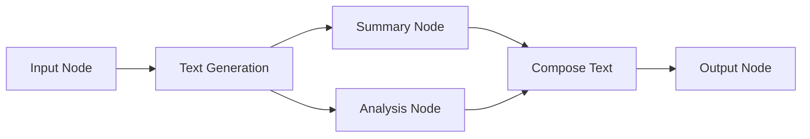

## What are Workflows?

Workflows in Noxus are visual, node-based programs that allow you to create complex AI automation by connecting different functional components. Think of them as flowcharts that can actually execute - each node performs a specific task, and the connections between nodes determine how data flows through your automation.


## Key Concepts

<CardGroup cols={2}>
  <Card title="Nodes" icon="circle-dot">
    Individual functional units that perform specific tasks like text generation, data processing, or logic operations
  </Card>
  <Card title="Edges" icon="arrow-right">
    Connections between nodes that define how data flows from one operation to another
  </Card>
  <Card title="Inputs & Outputs" icon="arrows-left-right">
    Data entry points and results that allow nodes to communicate with each other
  </Card>
  <Card title="Configuration" icon="gear">
    Settings that customize how each node behaves and processes data
  </Card>
</CardGroup>

## Workflow Architecture

Workflows are built as **directed graphs** where:

- **Nodes** represent operations (AI models, data transformations, logic gates, etc.)
- **Edges** represent data flow between operations
- **Execution** follows the graph structure, processing nodes when their inputs are ready



## Node Types

<AccordionGroup>
  <Accordion title="Input/Output Nodes" icon="arrows-left-right">
    - **InputNode**: Entry points for data into your workflow
    - **OutputNode**: Final results and endpoints for your workflow
    - **FileInputNode**: Handle file uploads and processing
  </Accordion>

  <Accordion title="AI & Language Models" icon="brain">
    - **TextGenerationNode**: Generate text using various AI models
    - **SummaryNode**: Create summaries of text content
    - **TranslationNode**: Translate text between languages
    - **EmbeddingNode**: Generate vector embeddings for text
  </Accordion>

  <Accordion title="Data Processing" icon="database">
    - **ComposeTextNode**: Combine multiple text inputs
    - **ExtractTextNode**: Extract text from documents
    - **DataTransformNode**: Transform and manipulate data
    - **FilterNode**: Filter data based on conditions
  </Accordion>

  <Accordion title="Logic & Control" icon="code-branch">
    - **ConditionalNode**: Branch execution based on conditions
    - **LoopNode**: Repeat operations over collections
    - **SwitchNode**: Route data based on values
    - **MergeNode**: Combine multiple data streams
  </Accordion>

  <Accordion title="External Integrations" icon="plug">
    - **APICallNode**: Make HTTP requests to external services
    - **DatabaseQueryNode**: Query databases
    - **WebScraperNode**: Extract data from web pages
    - **EmailNode**: Send emails and notifications
  </Accordion>
</AccordionGroup>

## Workflow Lifecycle

<Steps>
  <Step title="Design">
    Create your workflow by adding nodes and connecting them to define the data flow
  </Step>
  <Step title="Configure">
    Set up each node with the appropriate parameters and settings
  </Step>
  <Step title="Validate">
    Ensure all connections are valid and required inputs are provided
  </Step>
  <Step title="Save">
    Store your workflow definition in the Noxus platform
  </Step>
  <Step title="Execute">
    Run your workflow with input data and monitor the results
  </Step>
  <Step title="Monitor">
    Track execution progress and handle any errors or issues
  </Step>
</Steps>

## Simple Workflow Example

Here's a basic workflow that takes user input and generates an AI response:

```python
from noxus_sdk.client import Client
from noxus_sdk.workflows import WorkflowDefinition

# Initialize client
client = Client(api_key="your_api_key_here")

# Create workflow definition
workflow_def = WorkflowDefinition(name="Simple AI Assistant")

# Add nodes
input_node = workflow_def.node("InputNode").config(
    label="User Question",
    type="str"
)

ai_node = workflow_def.node("TextGenerationNode").config(
    template="Answer this question helpfully: ((User Question))",
    model=["gpt-4o-mini"],
    temperature=0.7,
    max_tokens=200
)

output_node = workflow_def.node("OutputNode")

# Connect nodes
workflow_def.link(input_node.output(), ai_node.input("variables", "User Question"))
workflow_def.link(ai_node.output(), output_node.input())

# Save workflow
workflow = client.workflows.save(workflow_def)
print(f"Created workflow: {workflow.id}")
```

## Complex Workflow Example

Here's a more sophisticated workflow that processes documents:

```python
# Create document processing workflow
workflow_def = WorkflowDefinition(name="Document Processor")

# Input nodes
doc_input = workflow_def.node("FileInputNode").config(
    label="Document",
    accepted_types=["pdf", "docx", "txt"]
)

topic_input = workflow_def.node("InputNode").config(
    label="Analysis Topic",
    type="str",
    fixed_value=True,
    value="key insights and recommendations"
)

# Processing nodes
extract_text = workflow_def.node("ExtractTextNode")

summarizer = workflow_def.node("SummaryNode").config(
    summary_format="Bullet Points",
    summary_topic="Main points and conclusions",
    max_length=300
)

analyzer = workflow_def.node("TextGenerationNode").config(
    template="Analyze this document for ((Analysis Topic)):\n\n((Document Text))",
    model=["gpt-4o-mini"],
    temperature=0.3
)

# Combine results
composer = workflow_def.node("ComposeTextNode").config(
    template="""# Document Analysis Report

## Summary
((Summary))

## Analysis
((Analysis))

## Generated on: {{current_date}}
"""
)

output_node = workflow_def.node("OutputNode")

# Connect the workflow
workflow_def.link(doc_input.output(), extract_text.input())
workflow_def.link(extract_text.output(), summarizer.input())
workflow_def.link(extract_text.output(), analyzer.input("variables", "Document Text"))
workflow_def.link(topic_input.output(), analyzer.input("variables", "Analysis Topic"))
workflow_def.link(summarizer.output(), composer.input("variables", "Summary"))
workflow_def.link(analyzer.output(), composer.input("variables", "Analysis"))
workflow_def.link(composer.output(), output_node.input())

# Save the workflow
doc_processor = client.workflows.save(workflow_def)
```

## Workflow Benefits

<CardGroup cols={2}>
  <Card title="Visual Programming" icon="eye">
    Design complex logic flows without writing traditional code
  </Card>
  <Card title="Reusability" icon="recycle">
    Create workflows once and run them multiple times with different inputs
  </Card>
  <Card title="Scalability" icon="chart-line">
    Handle large volumes of data and concurrent executions
  </Card>
  <Card title="Maintainability" icon="wrench">
    Easy to modify and update workflow logic as requirements change
  </Card>
  <Card title="Collaboration" icon="users">
    Share workflows with team members and build on each other's work
  </Card>
  <Card title="Monitoring" icon="chart-bar">
    Track execution history, performance metrics, and error rates
  </Card>
</CardGroup>

## Use Cases

<AccordionGroup>
  <Accordion title="Content Generation" icon="pen-to-square">
    - Blog post creation with research and fact-checking
    - Social media content generation
    - Product descriptions and marketing copy
    - Email campaigns and newsletters
  </Accordion>

  <Accordion title="Document Processing" icon="file-text">
    - PDF analysis and summarization
    - Contract review and extraction
    - Research paper processing
    - Legal document analysis
  </Accordion>

  <Accordion title="Data Analysis" icon="chart-line">
    - Customer feedback analysis
    - Market research processing
    - Survey data interpretation
    - Trend analysis and reporting
  </Accordion>

  <Accordion title="Customer Support" icon="headset">
    - Automated ticket classification
    - Response generation
    - Knowledge base queries
    - Escalation routing
  </Accordion>

  <Accordion title="Business Automation" icon="building">
    - Lead qualification
    - Report generation
    - Process automation
    - Decision support systems
  </Accordion>
</AccordionGroup>

## Best Practices

<AccordionGroup>
  <Accordion title="Design Principles" icon="compass">
    - Keep workflows focused on a single purpose
    - Use descriptive names for nodes and connections
    - Group related operations together
    - Plan for error handling and edge cases
  </Accordion>

  <Accordion title="Performance Optimization" icon="rocket">
    - Minimize the number of AI model calls
    - Use caching for repeated operations
    - Process data in batches when possible
    - Consider parallel execution paths
  </Accordion>

  <Accordion title="Error Handling" icon="exclamation-triangle">
    - Add validation nodes for input data
    - Include fallback paths for failures
    - Use conditional nodes for error routing
    - Log important intermediate results
  </Accordion>

  <Accordion title="Testing & Validation" icon="check-circle">
    - Test workflows with various input types
    - Validate outputs match expected formats
    - Monitor execution times and resource usage
    - Version control your workflow definitions
  </Accordion>
</AccordionGroup>

## Getting Started

Ready to build your first workflow? Here's what to do next:

<CardGroup cols={2}>
  <Card
    title="Building Workflows"
    icon="hammer"
    href="/workflows/building-workflows"
  >
    Learn the fundamentals of creating workflows with the SDK
  </Card>
  <Card
    title="Running Workflows"
    icon="play"
    href="/workflows/running-workflows"
  >
    Execute workflows and handle results
  </Card>
  <Card
    title="Node Types"
    icon="circle-nodes"
    href="/workflows/node-types"
  >
    Explore all available node types and their configurations
  </Card>
  <Card
    title="Examples"
    icon="code"
    href="/workflows/examples"
  >
    See real-world workflow examples and patterns
  </Card>
</CardGroup>

## Advanced Topics

<Note>
  Once you're comfortable with basic workflows, explore advanced topics like conditional logic, loops, external integrations, and workflow optimization techniques.
</Note>
